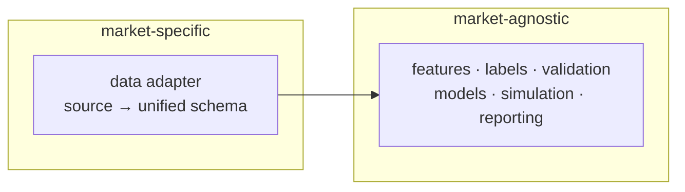

# Decisions and Design Rationale

Record of **why** this project is built the way it is. [SPEC.md](./SPEC.md) says *what*
the system must do; this file says *why* and *what was rejected*.

**How to use this file:** it is append-only. Do not rewrite a past decision to match new
code. If a decision changes, add a new row that supersedes the old one and mark the old row
`superseded by D-xx`. Every non-trivial implementation choice should be traceable to a row
here.

**Status legend:** `active` · `open` · `superseded`

---

## 1. Foundational decisions

| ID | Question | Decision | Rationale | Status |
|---|---|---|---|---|
| D-01 | Market / cadence | Crypto perpetual futures, **hourly** | 24/7, free API, hourly = genuinely new problem vs. weekly large caps | active |
| D-02 | Futures vs. crypto | **Crypto perps only** (Binance USDⓈ-M) | US index futures have no good free non-YF source; perps give funding/OI/liquidations for free | active |
| D-03 | Time budget | ~60h, phased delivery | Build incrementally, one module at a time | active |
| D-04 | Strategy angle | **Cross-sectional long-short** | Hits "new strategy" + "portfolio optimization" + per-ticker EDA points | active |
| D-05 | Horizon | **24h forward**, daily rebalance | Costs are ~1/24 of signal horizon; hourly bars still used for features and entry timing | active |
| D-06 | Target type | **Dual:** regression + classifier | Regression for ranking, probability for conviction sizing and threshold rules | active |
| D-07 | Universe | **150–250 liquid symbols**, BTC as anchor | Satisfies >1M records; enables cross-section; survivorship bias discussed explicitly | active |
| D-08 | Feature sources | Binance futures + **Crypto Fear & Greed** | 20+ features from one API, no scraping risk; F&G is a cheap extra source | active |
| D-09 | Models | **Ridge → RandomForest → XGBoost** | Baseline IC floor, lecture requirement, new model; all tabular, all tunable | superseded by D-36 |
| D-10 | Strategy ladder | **long-only → long-short → risk-managed** | Natural difficulty ramp, each step adds a rubric point | active |
| D-11 | Stack | **uv + GitHub Actions cron + Streamlit Community Cloud** | All free; public repo = unlimited Actions minutes | active |
| D-12 | Cost constraint | **100% free tools, no payments** | Hard constraint from author | active |
| D-13 | Data storage | **Hugging Face Datasets** | Free, no card, parquet-native, versioned, app can pull latest snapshot | active |
| D-14 | Validation | **Purged walk-forward, monthly retrain, 24h embargo — dev period only** | Prevents overlap leakage from 24h labels; the holdout is separate (D-24) | active |
| D-15 | Benchmarks | **BTC HODL + equal-weight basket + cash** | Preempts "not comparable" criticism of a market-neutral book | active |
| D-16 | Bonus items | **Telegram bot → Binance testnet** | Two rubric points, two distinct learning areas, zero cost/risk | active |
| D-17 | First build step | **Repo scaffold** | Fix interfaces before writing pipeline code | active |
| D-33 | Secondary data source | **FRED macro series**: `VIXCLS`, `DGS10`, `DFF`, `DTWEXBGS`, `BAMLH0A0HYM2` (extends D-08) | The rubric's bolded data-source point requires a source *from the lectures*. Binance is the "new source" point; FRED covers the lecture source. The series also double as risk-on/risk-off regime features, which a crypto cross-section lacks otherwise. | active |
| D-34 | Rule-based baseline | **`sim0`**: funding-carry rule, no model — long the 20 most-negative funding rates, short the 20 most-positive (extends D-10) | The course explicitly asks whether ML beats simple hand-written rules. A baseline gives the model a floor to beat and turns "ML adds value" into a testable claim rather than an assumption. Built before sim1/sim2 so all four share one cost model. | active |
| D-35 | Development method | **AI coding agents used deliberately**, transferring the practice from the AI Dev Tools Zoomcamp: spec first, decision record, task decomposition, explicit agent rules | No rule prohibits it. The value is in the process, not the speed. Domain choices, hypotheses, thresholds and verdicts stay with the author; disclosure is in the README. | active |
| D-36 | Model set | **Lecture models only + one regression study** (supersedes D-09): DecisionTree, RandomForest, LogisticRegression — plus Ridge on the continuous target. No XGBoost, no neural net, no ARIMA | Simplicity is the point: every model is explainable in one sentence, and the course never touched XGBoost. The bolded rubric point needs a lecture model (RandomForest); "more than one lecture model" needs two (add DecisionTree); "new models: … Regression" is earned by the regression study, which the course does not do anywhere. Models beyond the course are reserved for the ML Zoomcamp project rather than duplicated here. | active |
| D-37 | Build order | **Build the progress surface before the data layer** (P0-15…P0-18): artifact schemas, `io/artifacts.py`, `cli status`, then the Streamlit dashboard | The app can only read artifacts, so building it first forces the output contracts to be written before four phases of code depend on them. It also makes every later phase visible the moment it produces a file, and the dashboard is required anyway (rubric 7.3). Cost: ~2h with no rubric points yet. Constraint: the app is read-only and never computes a signal. | active |

---

## 2. Objective and research protocol

| ID | Question | Decision | Rationale | Status |
|---|---|---|---|---|
| D-22 | Project objective | **A reusable research template**, with the crypto run as its first documented instance. Profitability is a reported outcome, not a target. | The rubric does not require a profitable model (only 1 of 36 points mentions profit, comparatively). A template transfers to future projects; a single backtest does not. | active |
| D-23 | How a result is judged | Three verdict states: **supported / falsified / inconclusive** | "It didn't work" collapses two very different outcomes. A falsified hypothesis prunes the search space; an underpowered test prunes nothing. | active |
| D-24 | Data splits | **Dev:** 2021-01 → 2025-10. **Sealed holdout:** 2025-11 → 2026-10. | 12 months of untouched data is long enough to span more than one regime, and leaves ~4.8 years for iteration. | active |
| D-25 | Iteration policy | Iterate freely on dev; every iteration must have a stated reason and be logged | Real model development needs iteration. What corrupts a backtest is *unlogged* selection, not iteration itself. | active |
| D-26 | Experiment tracking | Markdown table in `experiments.md`: `run_id \| date \| change \| reason \| dev OOS metric \| verdict \| keep/drop` | No tooling, no cost, reviewable in a diff. MLflow/W&B add setup cost with no benefit at this scale. | active |
| D-27 | Plausibility guardrails | Metrics far outside expected ranges trigger a **leakage audit**, not celebration | "Numbers that make sense" is a sanity check. On 24h crypto cross-sections, rank IC > 0.10 or Sharpe > 3 is a bug far more often than an edge. | active |
| D-28 | Pruning rule | **Two-strike rule:** an idea that fails twice is dropped with a one-line reason | Prevents endless tuning of one weak idea; keeps the project moving to the next hypothesis. | active |
| D-29 | Live vs. holdout | Live performance is for **reporting and alerting only**. Retraining follows the pre-set monthly schedule, never a discretionary "Sharpe looks bad" trigger. | Otherwise live data silently becomes another validation set — the same selection-overfitting problem, with money attached. | active |
| D-30 | Proving reusability | Config-swap rerun (one changed setting) + a 5-line "Reuse" section in the README. **No second market adapter.** | Cheapest honest evidence. A second adapter proves the seam but imports a second dataset's problems into the timeline. | active |
| D-31 | Naming of splits | Walk-forward out-of-sample months are **"dev OOS"**. The word **"test"** is reserved for the sealed holdout. | Naming discipline. Calling a set you look at 40 times "test" is how a project convinces itself it has out-of-sample evidence. | active |
| D-32 | Threshold selection | Decision thresholds (`p_top_quintile`, stop-loss, vol target) are chosen on dev only | Choosing a threshold because it improves the holdout is equivalent to training on the holdout. | active |

---

## 3. Open decisions

| ID | Question | Recommendation | Blocks | Status |
|---|---|---|---|---|
| D-18 | Standalone `crypto-cross-pred/pyproject.toml` vs. root `uv` workspace member? | Standalone — Docker/CI target it cleanly, homework deps stay out of the image | P0-02 | **decided: standalone** (P0-02, `uv.lock` committed) |
| D-19 | Telegram: raw `requests` vs. `python-telegram-bot`? | Raw `requests` — ~30 lines, no polling, no extra dependency | P8-01 | open |
| D-20 | Symbol encoding: target-encode vs. top-N one-hot? | Target-encode inside the fold; keep top-20 symbols as dummies for interpretability | P2-07 | open |
| D-21 | Tuning inside or outside walk-forward? | Outside, on a dev window, params frozen for all folds — documented tradeoff | P4-06 | open |

---

## 4. Why a sealed holdout (and not just a test split)

Two different failure modes get confused:

| Failure | Mechanism | Fix |
|---|---|---|
| **Leakage** | The model sees future rows while training (e.g. overlapping 24h labels crossing a split boundary) | Purge + embargo (§6 of SPEC) |
| **Selection overfitting** | **The researcher** sees test results and chooses the model that looks best on them | Sealed holdout + pre-registered rule |

Purging does nothing about the second one, because the leak runs through the analyst's
decisions rather than through the rows. A test set you evaluate after every change stops
being a test set: it becomes a validation set with extra steps.

**Why one look is enough:** the holdout answers a single question — "does the model chosen
without this data perform as expected on it?" If you look twice and change something in
between, the second number answers a different, easier question.

**Why 12 months:** long enough to cover more than one volatility regime, short enough that
the dev period still spans ~4.8 years of iteration.

**Why not CPCV or nested CV:** statistically cleaner, but the implementation and runtime
cost is disproportionate to a 36-point rubric, and it does not solve the analyst-level
problem that the holdout solves.

---

## 5. Why "inconclusive" is a separate verdict

A negative result only prunes a hypothesis if the test could have detected an edge.

- **Falsified** — the test had adequate power and found no edge. The idea is dead; move on.
- **Inconclusive** — the effect is below the minimum detectable size, or costs swamp it.
  The idea is untested, not dead. Say so.
- **Supported** — the pre-registered criterion was met on the sealed holdout.

Reporting everything as "falsified" would be dishonest and would also prune ideas that
were never actually evaluated. The power check (TASKS P3-08) exists to keep these apart.

---

## 6. Why the template boundary is exactly one adapter

Everything downstream of the unified schema reads only that schema. That is what makes
"swap the market" a config change plus one adapter.

**Why not abstract further** (plugin registries, generic feature DSLs, a framework): with a
single market there is no evidence about where the *next* variation will be. Premature
abstraction produces a framework that fits one dataset and has to be rewritten for the
second. The rule: **no abstraction beyond the adapter seam until a second market actually
exists** (D-30).

---

## 7. Alternatives considered and rejected

| Alternative | Why rejected |
|---|---|
| Optimize for profitability | Not required by the rubric; encourages overfitting and makes a negative result look like failure |
| Single 70/15/15 split | One out-of-sample window; no regime coverage; easy to overfit by repeated evaluation |
| Test set evaluated every iteration | Becomes a validation set; gives false confidence |
| CPCV / nested CV | Complexity disproportionate to the rubric; does not solve analyst-level overfitting |
| MLflow / W&B for tracking | Setup and account overhead for a solo project; a markdown table is auditable in a diff |
| Second market adapter to prove reuse | Imports a second dataset's quality problems; a config swap demonstrates the seam at a fraction of the cost |
| Separate template package/repo | Turns a course project into a library project; high refactor risk, low rubric value |
| LSTM / sentiment / on-chain features | Scope creep; each adds a failure mode the timeline cannot absorb |
| XGBoost / Keras NN / ARIMA | Beyond the course's model set and not needed for any point (D-36). XGBoost and the neural-net family are reserved for the ML Zoomcamp project; ARIMA is univariate and cannot rank a 200-symbol cross-section |
| Liquidation features | Binance publishes no historical liquidation archive for USD-M futures, and `/fapi/v1/allForceOrders` only returns the last few days. The four features cannot be backfilled for 2021-2026, so they are dropped rather than shipped as all-NaN columns (SPEC §4.3) |
| Real-money broker integration | Unnecessary risk; testnet satisfies the bonus criterion |

---

## 8. Consequences we accept

- The final number is **one** run. If the holdout is spent carelessly, there is no honest
  retry — which is the point, and why the rule is pre-registered.
- Iteration on dev is cheap but not free: heavy tuning overfits dev OOS too, just more
  slowly. The experiment log is what keeps this visible.
- The template claim rests on structure and one config-swap demo, not on a second market.
  That is a weaker claim than "we ported it," stated plainly rather than overstated.
- A losing strategy is a valid, complete deliverable, provided the verdict is honest and
  the next idea is written down.

---

## 9. Course-rule evidence

The project relies on the following statements from the course criteria and FAQ. Recorded
here so the reasoning is auditable and does not have to be re-derived later.

| Claim | Source | Where it matters |
|---|---|---|
| Crypto projects are allowed | FAQ: "Can I do my project on crypto instead of stocks?" — "Yes." | D-01, D-02 |
| Fewer than 1M rows only costs 1 point | FAQ, same answer: "Having fewer than 1 million rows is fine (the data size is only worth 1 point)" | D-07 — the 1M target is an optimisation, not a gate |
| Prefer the exchange API over Yahoo Finance | FAQ, same answer: "consider using that exchange's API instead of Yahoo Finance" | D-01, D-33 |
| 10–20 tickers minimum to avoid overfitting | FAQ: "How many tickers should my project use?" | D-07 (we use 150–250) |
| Cross-course reuse is allowed if each course's criteria are met | FAQ: "Can I reuse this project for the MLOps Zoomcamp...?" — "Yes" | D-22 |
| The rubric does not require profitability | Criteria: one optional point, comparative only | D-22 |
| A lecture data source is required (bolded) | Criteria §2, bolded | D-33 |
| A lecture model is required (bolded) | Criteria §4, bolded | D-36 |
| Lecture models are exactly DecisionTree and RandomForest | Criteria §4, bolded: "One model from the lecture is used (DecisionTree, RandomForest)" | D-36 — Ridge does not satisfy this line; the second lecture-model point needs both |
| "More than one model from the lecture" is a separate point | Criteria §4 | D-36 — DecisionTree + RandomForest |
| Regression counts as a *new* model, not a lecture model | Criteria §4: "New models are introduced: XGBoost, Regression, Deep Neural Networks…" | D-36 — the regression study earns this point |
| No rule prohibits AI tooling | Criteria and FAQ contain no such rule; the only adjacent line is "the code must be your own", stated in the solo-vs-group answer | §9.1, D-35 |

**Lecture model inventory** (read from the downloaded course notebooks, 2025 and 2026 cohorts):

| Model | Module | How it is taught |
|---|---|---|
| ARIMA (`statsmodels`) | 3 | Per-ticker univariate, manual `(p,q,r)` grid |
| DecisionTreeClassifier | 3, 4, 5 | `max_depth` sweep, `plot_tree`, feature importance |
| RandomForestClassifier | 4, 5 | `n_estimators` / `max_depth` sweep |
| LogisticRegression | 4, 5 | With `StandardScaler` |
| Keras Sequential NN | 4, 5 | `Dense` + `Dropout` |

No XGBoost, LSTM, CatBoost, LightGBM or SVM appears in any notebook's code cells. The course
predicts direction only — no regressor is taught anywhere, which is why the regression study is
the natural extension rather than an extra model (D-36).

### 9.1 On AI tooling

AI coding agents are used **deliberately**, not incidentally. The method is carried over
from the AI Dev Tools Zoomcamp as transferable practice: write the specification before the
code, record decisions and rejected alternatives, decompose the work into verifiable tasks,
and give the agent explicit operating rules. That is exactly what `docs/SPEC.md`,
`docs/DECISIONS.md`, `docs/TASKS.md` and `AGENTS.md` are.

The division of labour:

- **Author:** domain choices, hypotheses, thresholds, verdicts, and the pivots in §10.
- **Agents:** implementation, refactoring, boilerplate, test scaffolding.
- **Review:** every generated change is checked against the invariants in `AGENTS.md` —
  no leakage, sealed holdout untouched, free tools only, no data in git.

Disclosure is stated in the README. The FAQ line "the code must be your own" appears in the
answer to "is the project solo or can I work in a group?", i.e. it prohibits submitting a
peer's project. No prohibition on tooling appears anywhere in the criteria or the FAQ. If a
reviewer reads it more strictly, the exposure is limited: the protocol, the decisions and
the verdicts remain the author's, and the implementation is reproducible from the spec.

---

## 10. Design pivots

Chronological record of what changed and why. This is the part that shows the project was
*directed* rather than generated.

| # | From | To | Trigger |
|---|---|---|---|
| 1 | A profitable strategy as the goal | A reusable research template; profitability is a reported outcome | The rubric does not require profit (only 1 comparative point), and a template transfers to the next project |
| 2 | Stop at the first negative result | Iterate on dev, log every run, prune at the idea level | A single negative run proves nothing without a power check |
| 3 | Single train/val/test split | Purged walk-forward on dev + sealed holdout | A test set evaluated after every change stops being a test set |
| 4 | Calling walk-forward OOS months "test" | "dev OOS"; "test" reserved for the holdout | Naming discipline prevents false confidence in the writeup |
| 5 | Binance as the only data source | Binance (new source) + FRED (lecture source) | The bolded rubric point requires a source from the lectures |
| 6 | Three simulation strategies | Four, with `sim0` rule baseline first | Answers the course's own question: does ML beat a simple rule? |
| 7 | Docs at the project root | Docs in `docs/`; `AGENTS.md` stays at root | Tidiness without breaking agent discovery |
| 8 | Naming: `project_1`, `crypto_ls` | `crypto-cross-pred`, `crypto_cross_pred` | Consistency across course projects |
| 9 | Ridge → RandomForest → XGBoost | Lecture models only (DecisionTree, RandomForest, LogisticRegression) + a regression study | Reading the actual course notebooks showed XGBoost is never taught; the rubric's new-model point is better earned by the regression study, and the exotic models are reserved for the ML Zoomcamp project |
| 10 | Build order: data → features → models → sim → app | Artifact contracts and the dashboard come before the data layer | An app that reads artifacts forces the output schemas to be defined first; it also makes each phase visible as it lands, and the dashboard is required anyway |

Each pivot is a decision, not a correction of an error: the earlier version was reasonable
given what was known at the time.
