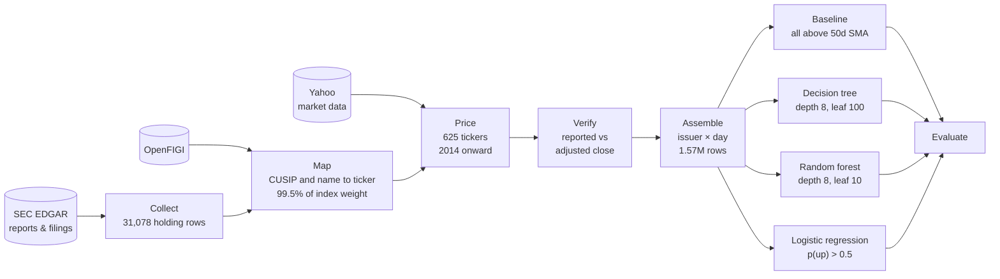
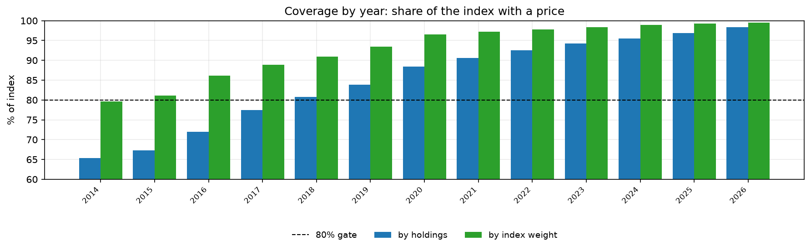
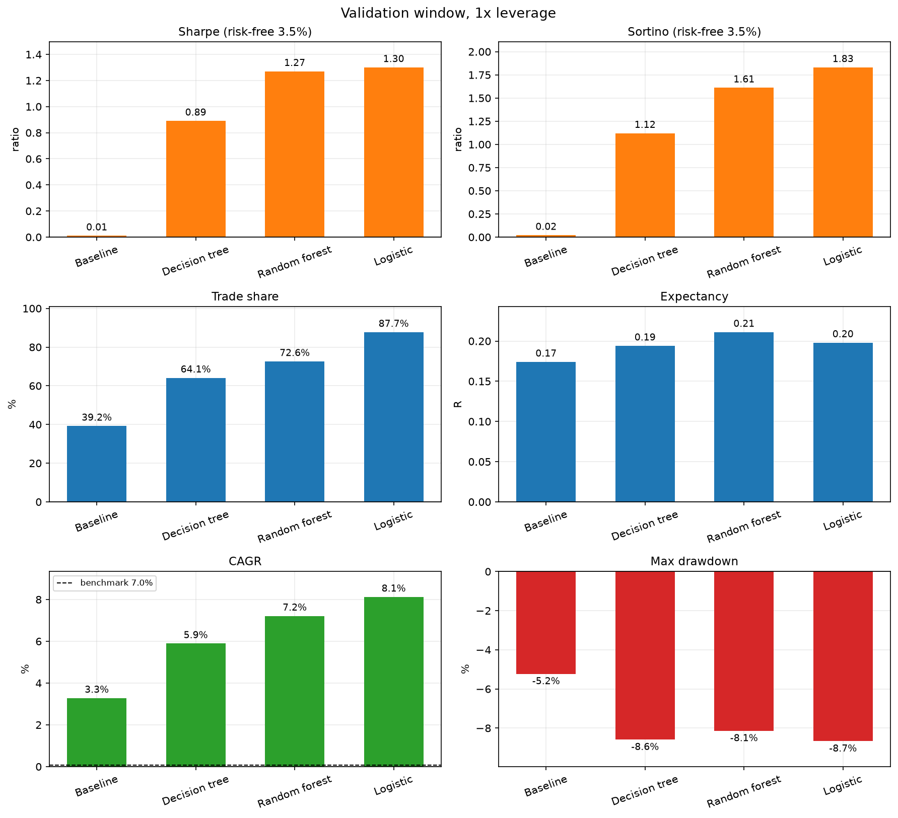
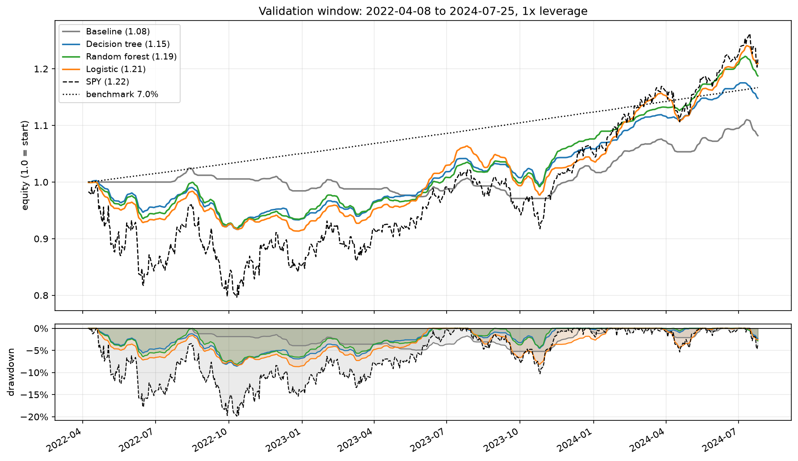
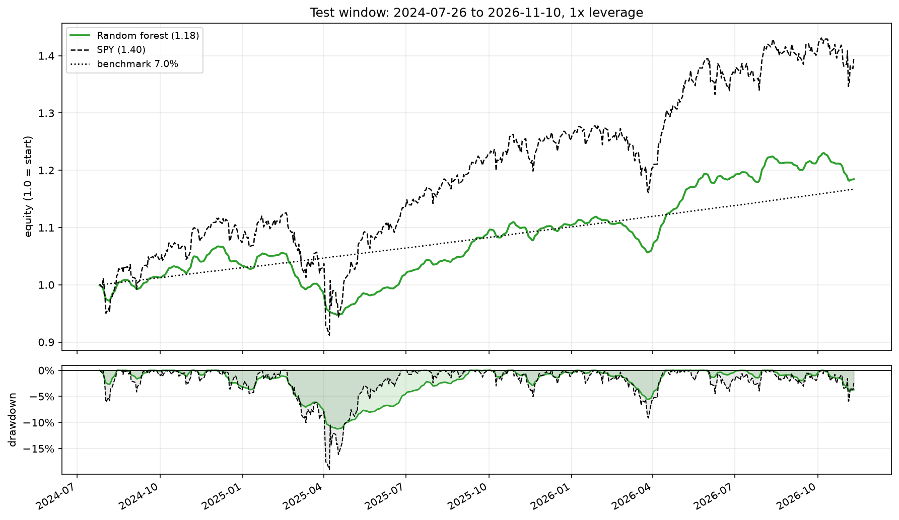

# Index Breadth Momentum

## Problem

Everyone knows about market breadth, yet few know how to actually trade it. The standard approach treats it as a simple barometer for whether the market is getting healthier or weaker. We put that traditional "above the 50-day moving average" rule to the test, and it fell flat: it stayed in the market only 39% of the time and yielded a 3.28% annual return, missing the 7% fixed-income hurdle by a wide margin. Breadth itself isn't useless, the missing piece is turning it into a systematic rule that can outperform both the basic baseline and the 7% benchmark.

## Solution

Build a trading model that predicts SPY using only breadth metrics aggregated from individual S&P 500 stocks, with zero direct SPY inputs. The model targets forward 5-day SPY returns measured in 20-day ATR units, and evaluated based on expectancy, CAGR, drawdown, and Sharpe ratio against a baseline model and a 7% fixed-income benchmark.

## Pipeline



| Term | Notes |
|---|---|
| SEC EDGAR | the SEC's free public filing archive; every fund reports what it holds there |
| OpenFIGI | a free lookup that turns a security identifier into a ticker |
| CUSIP | the 9-character ID funds actually report; broker platforms only show ticker |

Build details: [docs/pipeline.md](docs/pipeline.md) · column definitions:
[docs/schema.md](docs/schema.md) · excluded rows: [docs/exclusions.md](docs/exclusions.md).

## Data

Two files run the notebook, both attached to the `v0.1-data` release:
`data/constituents/sp500_constituents_daily.parquet` and `data/prices/SPY.parquet`. Nothing large is in git.

Download links, checksums and the rebuild commands: [DATA.md](DATA.md).



Coverage is the share of the index that still has a usable price. The 80% gate decides the study
window: weighted coverage is readable from 2014-12, equal weight from 2018-05.

### Why the study starts in 2015

Yahoo has no price history for delisted tickers (checked: Lehman, Enron, Bear Stearns,
Merrill all return zero rows). Breadth can only be computed on names that still carry a
price series, so usable history is shorter than holdings history.

Measured coverage per snapshot (`data/verify_report.csv`):

| period | `coverage_names` | `coverage_weight` |
|---|---|---|
| 1995-2013 | 0% | 0% |
| 2014-09-30 | 65% | 80% |
| **2016-09-30** | **73%** | **87%** |
| 2018-09-30 | 82% | 92% |
| 2019-09-30 | 84% | 94% |
| 2021-03-31 | 90% | 97% |
| 2025-03-31 | 97% | 99% |

`coverage_names` counts holdings; `coverage_weight` counts index weight. They differ
because the missing names are not random. Lucent (1.9% of the index in 1999), Sun Microsystems
(1.5%), Nortel (1.4%) and WorldCom (1.3%) all lack a price series, as do Lehman, Enron, Merrill,
Wachovia and Washington Mutual. Size was no protection: delisting or acquisition removed the price
history, not the company's importance while it was in the index.

**Study window: 2015-06-01 onward, 2,880 modelled days.** Weighted breadth is readable from
2014-12-01, equal-weight from 2018-05-29 — each gated on its own denominator at 80%. The first
usable row is 2015-06-01 because the longest features (200-day SMA, 52-week extremes) need their
warm-up. Every row carries `coverage_names`, `coverage_weight`, `weighted_ok` and `equal_weight_ok`,
so the reader can see exactly what backs each date. A stricter 90-95% subset is a filter away, not the
default, but picking it after seeing the test result would be curve-fitting, so it was not done.

Dates before 2014 stay in the holdings store but are excluded — the 2000-02 dot-com bust and the
2007-09 Global Financial Crisis (GFC) each lose 60-80% of their members.

### Verification

`holding_value / shares` is the price the fund reported. Multiply the Yahoo close by every split
after the period and the two must agree:

| | 2016 | 2020 | 2026 |
|---|---|---|---|
| `coverage_names` | 70% | 88% | 99% |
| `coverage_weight` | 84% | 96% | 99% |
| `match_names` | 70% | 88% | 99% |

17 rows disagreed before exclusions. After `config/exclusions.csv` is applied, **0 rows**
disagree (0.00% of weight). Every excluded row is explained in
[docs/exclusions.md](docs/exclusions.md).

## Notebook

`notebook.ipynb` is the whole study, in order:

| Section |   |
|---|---|
| Setup | constants, targets, helper functions |
| Processing | SPY daily bars, then per-issuer indicators from the constituent table |
| Modelling | breadth aggregates, medians, the 5-day frame, 32 features, 60/20/20 date split |
| Models | baseline, tuned decision tree, tuned random forest, logistic regression |
| Evaluation | KPI table, equity and drawdown charts, final refit, test score, interpretation |

Every model is selected on validation only. The last section refits the chosen forest on train +
validation and evaluates it once on the test block, so the final numbers are genuinely out of
sample.

## Features

32 features, all derived from constituents, plus one target.

| Group | Columns | Idea |
|---|---|---|
| Above-SMA breadth | `breadth_sma_5d/20d/60d` | share of issuers above their own moving average |
| Overbought / oversold | `breadth_rsi70_*`, `breadth_rsi30_*` | share of issuers with RSI above 70 or below 30 |
| Distance from trend | `med_rel_sma_{5,20,60}d_atr` | median distance from SMA, normalised by ATR |
| Momentum | `med_rsi_{5,20,60}d` | median issuer RSI |
| Volatility | `med_atr_pct_{5,20,60}d` | median ATR as a share of price |
| Participation | `breadth_adv_dec_{5,20,60}d` | advance/decline ratio across issuers |
| Extremes | `breadth_high_{13,26,52}w`, `breadth_low_*` | share at 13/26/52-week highs and lows |
| Breadth momentum | `breadth_sma_*_chg_5d` | 5-day change in breadth itself |
| Dispersion | `iqr_rel_sma_{5,20,60}d` | interquartile range of distance from trend |
| Turnover | `breadth_turnover_rel_60d` | relative turnover against its own 60-day base |

**Target:** `rr_5d`, the forward 5-day SPY return measured in 20-day ATR units. Features come from `close`, while the `rr_5d` label comes from `adj_close`, because a level must be a real traded price, whereas a return must include dividends or a dividend day drops looks like a fake loss. Both are Yahoo's series already restated for splits; our split table is used only to verify that restatement, never to adjust prices.

## Results

Tuned on validation (2022-04 → 2024-07), then refit on train + validation and scored once on the
untouched test block (2024-07-26 → 2026-11-10). Fees are charged per trade at 0.005R; no tax is
deducted, because both the strategy and the benchmark are pre-tax.



**Validation:**

| Model | Trade Share | Expectancy | CAGR | Max Drawdown | Sharpe |
|---|---|---|---|---|---|
| Baseline (all above 50d SMA) | 39.2% | 0.174R | 3.28% | −5.23% | 0.01 |
| Decision tree | 64.1% | 0.194R | 5.89% | −8.59% | 0.89 |
| **Random forest** | **72.6%** | **0.211R** | **7.21%** | **−8.14%** | **1.27** |
| Logistic regression | 87.7% | 0.198R | 8.12% | −8.67% | 1.30 |



The forest was chosen for the best expectancy at materially lower exposure than logistic
(72.6% vs 87.7%), which is close to buy-and-hold.

**Test (Final model only):**

| Model | Trade Share | Expectancy | CAGR | Max Drawdown | Sharpe |
|---|---|---|---|---|---|
| Random forest | 90.8% | 0.167R | 7.08% | −11.23% | 1.06 |



Ending equity over the test window: **1.184** for the model, **1.167** for the 7% benchmark,
**1.396** for SPY buy-and-hold. SPY's worst drawdown in that window was −18.8%, the model's −11.2%.

**The honest reading**: model barely cleared bond threshold and lost to the index by a wide margin. Even worse, the days it sat
out averaged +0.248R against +0.167R when it executed a trade (negative selection). Leverage does not fix
this: at 2× the drawdown would be about −22%, worse than SPY's −18.8%, so the return only improves
by taking on more risk than the index itself. Full discussion in
[notebook.ipynb](notebook.ipynb), last two cells.

**What might improve it:**

1. **Better coverage:** more historical constituents and prices, especially pre-2019, to widen the window and reduce survivorship bias.
2. **Other horizons:** 20-day and 60-day targets, where breadth signals are more likely to carry information than at 5 days.
3. **Other models:** gradient boosting (XGBoost/LightGBM), and a classification target with probability-based sizing instead of fixed exposure.
4. **Regime conditioning:** trade breadth signals only when volatility or trend regimes make participation meaningful.Z
5. **Point-in-time sector and fundamentals:** — sector breadth and earnings data, if a reliable historical source can be licensed.

## Reproduce

The notebook reads both parquet files straight from the `v0.1-data` release URL, so nothing needs to
be downloaded first:

```bash
cd index-breadth-momentum
uv sync
uv run jupyter lab notebook.ipynb     # run all cells, top to bottom
```

Runtime is about 40 seconds on a laptop.

## Quality-of-life scripts

Double-click any of these from `index-breadth-momentum/`:

| Script | What it does | Environment | Approx. time |
|---|---|---|---|
| `run_notebook.bat` | Open JupyterLab (`exec` runs top-to-bottom and writes `docs/notebook.html`) | full | open: seconds; exec: ~2 min |
| `run_tests.bat` | Run the 44 schema and data-contract tests | full | ~40 s |
| `run_pipeline.bat` | Rebuild the dataset from SEC EDGAR, module by module | full | ~20 min |
| `setup.bat` | `uv sync` the shared environment, then list the rest | full | ~10 s |

`full` = the root `uv sync`.

### Build-up from scratch

```
git clone <repo-url>
        |
        v
cd sma-cohort-2026/index-breadth-momentum
        |
        v
double-click setup.bat
        |
        v
double-click run_notebook.bat   -> the study, top to bottom
        |
        v
double-click run_tests.bat      -> 44 tests
```

Optional:

```
run_notebook.bat exec   -> re-run it and refresh docs/notebook.html
run_pipeline.bat        -> full EDGAR rebuild (network, ~20 min)
```

## Run

To rebuild the dataset from SEC EDGAR instead of using the release, run these in order and point the
two `pd.read_parquet` calls in the notebook at the local files. Checksums: [DATA.md](DATA.md).

```bash
cd index-breadth-momentum
uv run python -m breadth.edgar      # holdings      (~2 min, 68 requests)
uv run python -m breadth.tickers    # cusip -> ticker (~10 min first time, cached)
uv run python -m breadth.holdings   # mapped layer  (adds ticker + issuer_id)
uv run python -m breadth.exclusions # ticker-reuse rows -> config/exclusions.csv
uv run python -m breadth.prices     # daily bars    (~5 min)
uv run python -m breadth.verify     # reconciliation
uv run python -m breadth.constituents  # constituent table
uv run pytest -q                    # schema contracts
```

Notebook environment: TA-Lib **0.8.3** installs from wheels (`uv add ta-lib`) and gives
`talib.SMA(close, 200)` with 199 leading NaNs, which is the warm-up behaviour we want.
`pandas_ta`, `ta` and `talipp` also import cleanly if a pure-Python package is preferred.

## Notes

- Filings are late (~2 months), so use `available_at`, never `period`, for point-in-time joins.
- Levels use split-adjusted `close`; changes use total-return `adj_close`. Never mix them
  (see [docs/schema.md](docs/schema.md#price-basis-rule)).
- `data/` is gitignored; nothing from EDGAR or Yahoo is committed.

Details: [docs/schema.md](docs/schema.md) for every column and definition,
[docs/pipeline.md](docs/pipeline.md) for how it is built,
[docs/exclusions.md](docs/exclusions.md) for why 15 holdings have no ticker,
[docs/tasks-data-cleanup.md](docs/tasks-data-cleanup.md) for what is still unsafe.
